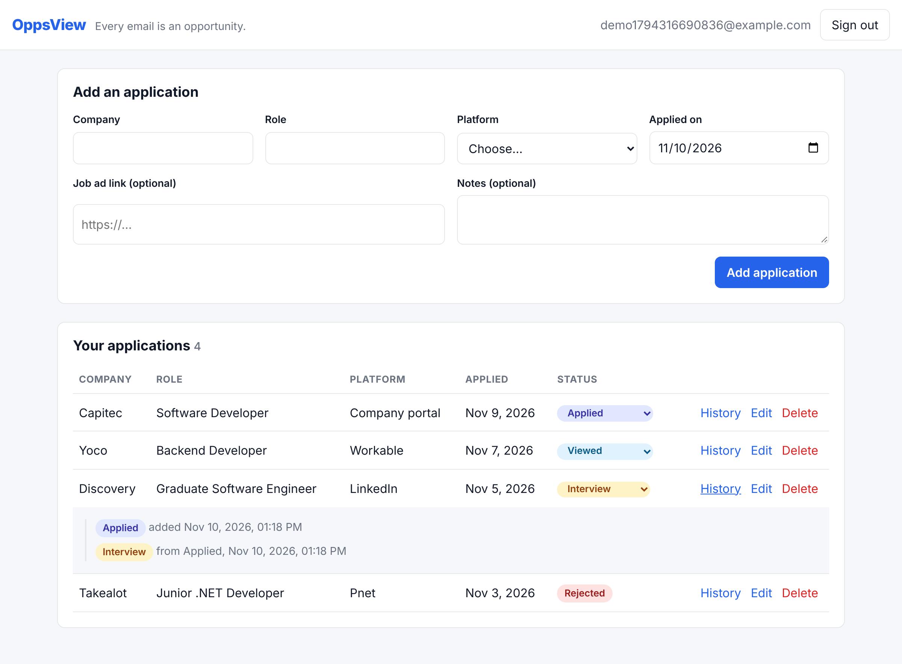

# OppsView

**Every email is an opportunity.**

Job hunting means sending dozens of applications across Pnet, Indeed, LinkedIn, Workable and company portals, then losing track of which ones replied. OppsView keeps them all in one place. Log each application, move it through the pipeline (Applied, Viewed, Interview, Offer, Rejected) and see the full history of every status change.

Later phases will make it smarter: a CV matcher that scores your CV against a job ad and lists the skills you're missing, automatic import of confirmation and rejection emails from Gmail, follow-up reminders when a company goes quiet, and a dashboard that shows your response rate by platform and where your applications stall.



This repository is a portfolio project, built in phases. Each phase adds a service in a different stack.

| Phase | Service | Stack | Status |
|---|---|---|---|
| 1 | [`api/`](api/README.md): applications, status history, accounts | ASP.NET Core 8, EF Core, PostgreSQL, JWT | ✅ done |
| 1 | [`web/`](web/README.md): the tracker UI | React 19, TypeScript, Vite | ✅ done |
| 2 | [`matcher/`](matcher/README.md): CV vs job ad match score and missing skills | Python, FastAPI | planned |
| 3 | Email import: read Pnet / Indeed / Workable confirmation and rejection emails | Gmail API (OAuth, read-only) | planned |
| 4 | [`notifier/`](notifier/README.md): follow-up reminders after N days | Java, Spring Boot, RabbitMQ | planned |
| 5 | [`dashboard/`](dashboard/README.md): analytics, plus CI and Azure deployment | Angular, GitHub Actions, Azure | planned |

## Architecture (Phase 1)

```
 Browser                       ASP.NET Core 8 API                     PostgreSQL
┌──────────────┐  HTTPS/JSON  ┌──────────────────────────────────┐   ┌──────────────┐
│ React + Vite │ ───────────▶ │ Controllers (thin)               │   │ Users        │
│  :5173       │  Bearer JWT  │   → Services (use cases, scoped  │──▶│ Applications │
│              │ ◀─────────── │       to the signed-in user)     │   │ StatusHistory│
└──────────────┘              │   → Domain (entities + rules)    │   └──────────────┘
                              │   → EF Core (AppDbContext)       │
                              │  :5226                           │
                              └──────────────────────────────────┘
```

Key design decisions:

- **Rules live in the domain entities.** `JobApplication` has private setters, and every change goes through `Create`, `UpdateDetails` or `ChangeStatus`. Validation, the status rules and history recording are each in one place, whichever endpoint is used.
- **Status only moves forward.** Applied → Viewed → Interview → Offer, and an application can be Rejected from any non-final stage. Stages can be skipped. Offer and Rejected are final. Every change writes a `StatusHistory` row, which is what the Phase 5 "where do applications stall" analytics will use. The API returns `allowedNextStatuses` with each application, so the UI never duplicates the rules.
- **Data is scoped per user.** Every query starts from "the current user's applications". Another user's application looks the same as a missing one (404), so the API never reveals which ids exist.
- **No secrets in the repo.** The connection string and the JWT signing key come from .NET user-secrets locally and from environment variables in CI and Azure. `.env` is git-ignored, and `.env.example` documents what goes in it.
- **Tests exercise the real pipeline.** API integration tests boot the real app with `WebApplicationFactory`, running on in-memory SQLite (a real relational database) with a fake clock.

## Running it locally

You need:

- [.NET 8 SDK](https://dotnet.microsoft.com/download/dotnet/8.0)
- [Node.js 20+](https://nodejs.org/)
- PostgreSQL 16 or 17. Option A installs it natively (no Docker needed). Option B uses Docker.

The commands below are for PowerShell on Windows. They work the same in a macOS/Linux shell, except for generating the signing key (see step 3).

### 1. Get the code

```powershell
git clone https://github.com/sydneyzinyama-analyst/OppsView.git
cd OppsView
```

### 2. Create the database

#### Option A: native PostgreSQL, no Docker (Windows)

1. Install PostgreSQL 17 with the [EDB installer](https://www.postgresql.org/download/windows/). Keep the default port, 5432. Remember the password you choose for the `postgres` superuser.
2. Open a PowerShell window and connect as `postgres`. If `psql` isn't on your PATH, use the full path:

   ```powershell
   & "C:\Program Files\PostgreSQL\17\bin\psql.exe" -U postgres
   ```

3. Create a dedicated user and database for OppsView (choose your own password):

   ```sql
   CREATE ROLE oppsview LOGIN PASSWORD 'choose-a-password';
   CREATE DATABASE oppsview OWNER oppsview;
   \q
   ```

   You can do the same in pgAdmin: right-click Login/Group Roles and choose Create, then right-click Databases and choose Create.

#### Option B: Docker

```powershell
Copy-Item .env.example .env   # then edit POSTGRES_PASSWORD in .env
docker compose up -d
```

### 3. Configure the API (user-secrets)

[User-secrets](https://learn.microsoft.com/aspnet/core/security/app-secrets) are stored in your user profile (`%APPDATA%\Microsoft\UserSecrets\`), outside the repo, and are only loaded in the Development environment.

```powershell
cd api
dotnet tool restore     # installs the pinned dotnet-ef from .config/dotnet-tools.json

dotnet user-secrets set "ConnectionStrings:Default" "Host=localhost;Port=5432;Database=oppsview;Username=oppsview;Password=choose-a-password" --project src/OppsView.Api
```

The JWT signing key must be random and at least 32 characters. Generate one and store it:

```powershell
$bytes = New-Object byte[] 48
[Security.Cryptography.RandomNumberGenerator]::Create().GetBytes($bytes)
dotnet user-secrets set "Jwt:SigningKey" ([Convert]::ToBase64String($bytes)) --project src/OppsView.Api
```

On macOS/Linux: `dotnet user-secrets set "Jwt:SigningKey" "$(openssl rand -base64 48)" --project src/OppsView.Api`

### 4. Create the tables and run the API

```powershell
dotnet ef database update --project src/OppsView.Api
dotnet test
dotnet run --project src/OppsView.Api
```

The API runs at http://localhost:5226, with Swagger at http://localhost:5226/swagger. If a setting is missing, the API refuses to start and tells you which one.

### 5. Run the web app

In a second terminal:

```powershell
cd web
npm install
npm run dev
```

Open http://localhost:5173, create an account and add your first application.

## Repository layout

```
api/         ASP.NET Core API and its tests (see api/README.md)
web/         React app (see web/README.md)
matcher/     Phase 2 placeholder
notifier/    Phase 4 placeholder
dashboard/   Phase 5 placeholder
docs/        screenshots and, later, the architecture diagram
docker-compose.yml   optional PostgreSQL for Docker users and CI
```
