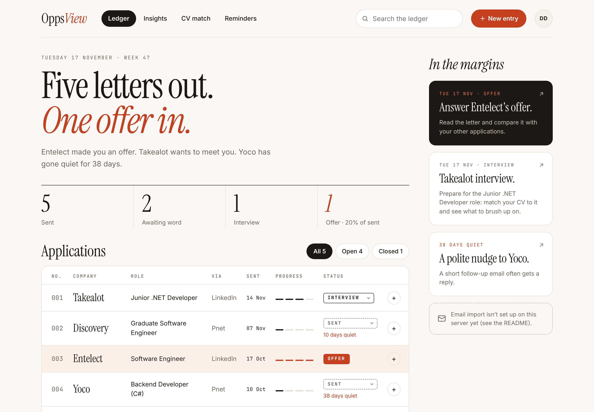
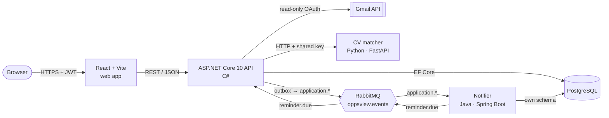

# OppsView

[](https://github.com/sydneyzinyama-analyst/OppsView/actions/workflows/ci.yml)

**Every email is an opportunity.**

Job hunting means sending dozens of applications across Pnet, Indeed, LinkedIn, Workable and company portals, then losing track of which ones replied. OppsView keeps them all in one place, and fills itself in: it reads the confirmation, rejection and interview emails in your inbox, adds each application automatically and keeps its status up to date. You can still add or correct applications by hand.

Every application moves through the pipeline (Applied, Viewed, Interview, Offer, Rejected) with a full history of every status change. A CV matcher scores your CV against a job ad and lists the skills you're missing. Follow-up reminders nudge you when a company goes quiet. An Insights page shows your applications per week, response rate by platform, where applications stall, and the skills you're most often missing.



This repository is a portfolio project, built in phases. Each phase adds a service in a different stack.

| Phase | Service | Stack | Status |
|---|---|---|---|
| 1 | [`api/`](api/README.md): applications, status history, accounts | ASP.NET Core 10, EF Core 10, PostgreSQL, JWT | ✅ done |
| 1 | [`web/`](web/README.md): the tracker UI | React 19, TypeScript, Vite | ✅ done |
| 2 | Email import: read confirmation, rejection and interview emails from Pnet, Indeed, Workable, LinkedIn and company portals, and create or update applications automatically | Gmail API (OAuth, read-only), in the .NET API | ✅ done |
| 3 | [`matcher/`](matcher/README.md): CV vs job ad match score and missing skills | Python, FastAPI | ✅ done |
| 4 | [`notifier/`](notifier/README.md): follow-up reminders after N days | Java, Spring Boot, RabbitMQ | ✅ done |
| 5 | Insights charts (in the React app), CI on every push, container images, Azure deployment | React, GitHub Actions, Docker, Azure | in progress: Azure deployment next |

## Architecture



| Service | Folder | Stack | Talks to |
|---|---|---|---|
| Web app | `web/` | React 19, TypeScript, Vite | the API only |
| API | `api/` | ASP.NET Core 10, EF Core 10 | PostgreSQL, Gmail, the matcher (HTTP), RabbitMQ (events) |
| CV matcher | `matcher/` | Python 3.13, FastAPI | nobody: called by the API |
| Notifier | `notifier/` | Java 25, Spring Boot 4 | RabbitMQ, its own schema in PostgreSQL |

Key design decisions:

- **Rules live in the domain entities.** `JobApplication` has private setters, and every change goes through `Create`, `UpdateDetails` or `ChangeStatus`. Validation, the status rules and history recording are each in one place, whichever endpoint is used.
- **Status only moves forward.** Applied → Viewed → Interview → Offer, and an application can be Rejected from any non-final stage. Stages can be skipped. Offer and Rejected are final. Every change writes a `StatusHistory` row, which is what the Phase 5 "where do applications stall" analytics will use. The API returns `allowedNextStatuses` with each application, so the UI never duplicates the rules.
- **Data is scoped per user.** Every query starts from "the current user's applications". Another user's application looks the same as a missing one (404), so the API never reveals which ids exist.
- **No secrets in the repo.** The connection string and the JWT signing key come from .NET user-secrets locally and from environment variables in CI and Azure. `.env` is git-ignored, and `.env.example` documents what goes in it.
- **Email import acts on what it recognises.** A rule-based parser reads each job email (confirmation, viewed, interview, offer, rejection, job alert) and finds the company, role and platform, falling back to the sender's address (and, for job sites like Pnet that never name the employer, the job site's name until the employer writes). Recognised emails create or update applications through the same domain methods as the API; a status email for a job OppsView never saw creates it with that status. Only emails it can't classify, or that name neither a company nor a job title, go to **Needs review**. Plain rules rather than machine learning, so every decision can be explained and tested against real (anonymised) emails.
- **Read-only, minimal storage.** OppsView asks Google only for `gmail.readonly`. It stores the sender, subject and the details it extracted, never email bodies. Google's refresh token is encrypted with ASP.NET Core Data Protection.
- **The CV matcher is a separate, internal service.** It's written in Python (FastAPI) and called only by the .NET API (optionally with a shared key), never by the browser, so login checks and data access stay in one place. Matching uses a skills catalogue (`matcher/src/matcher/skills.toml`) with aliases and implied skills; required skills weigh double, and "X or Y" counts as one requirement met by either. Only the CV's text is stored, not the file.
- **Event-driven reminders, with a transactional outbox.** Every application change is written as an event to an `OutboxMessages` table **in the same transaction** (an EF Core interceptor, so no code path can forget), then published to RabbitMQ in the background. An event can't be lost if RabbitMQ is down, and can't be sent for a change that was rolled back. The Java notifier keeps its own copy of the data in its own schema, plans reminders, and sends `reminder.due` back. Both sides handle duplicate and out-of-order delivery and use dead-letter queues. Neither service calls the other directly, so each keeps working while the other is down.
- **Ready for the internet.** Login and register are rate-limited per IP (10 a minute). `/health` and `/health/ready` let the hosting platform check each service. Encryption keys for stored tokens live in the database, so containers can restart freely. Every backend ships as a small, non-root container image.
- **Continuous integration.** GitHub Actions runs every service's lint, tests and build on each push and pull request (about 470 tests across xUnit, Vitest, pytest and JUnit), checks that EF migrations match the model, and builds the container images.
- **Tests exercise the real pipeline.** API integration tests boot the real app with `WebApplicationFactory`, running on in-memory SQLite (a real relational database) with a fake clock.

## Running it locally

You need:

- [.NET 10 SDK](https://dotnet.microsoft.com/download/dotnet/10.0) (`dotnet --list-sdks` should show a 10.0.x version)
- [Node.js 20+](https://nodejs.org/)
- PostgreSQL 16 or 17. Option A installs it natively (no Docker needed). Option B uses Docker.
- [Python 3.12+](https://www.python.org/downloads/) for the CV matcher (`scoop install python` on Windows)
- [Java 25](https://adoptium.net/) for the reminders notifier (`scoop bucket add java`, then `scoop install temurin-lts-jdk`), plus a free [CloudAMQP](https://www.cloudamqp.com) RabbitMQ instance

The commands below are for PowerShell on Windows. They work the same in a macOS/Linux shell, except for generating the signing key (see step 3).

### 1. Get the code

```powershell
git clone https://github.com/sydneyzinyama-analyst/OppsView.git
cd OppsView
```

### 2. Create the database

#### Option A: native PostgreSQL, no Docker (Windows)

1. Install PostgreSQL 17 with the [EDB installer](https://www.postgresql.org/download/windows/). Keep the default port, 5432. Remember the password you choose for the `postgres` superuser.
2. Open a PowerShell window and connect as `postgres`. If `psql` isn't on your PATH, use the full path:

   ```powershell
   & "C:\Program Files\PostgreSQL\17\bin\psql.exe" -U postgres
   ```

3. Create a dedicated user and database for OppsView (choose your own password):

   ```sql
   CREATE ROLE oppsview LOGIN PASSWORD 'choose-a-password';
   CREATE DATABASE oppsview OWNER oppsview;
   \q
   ```

   You can do the same in pgAdmin: right-click Login/Group Roles and choose Create, then right-click Databases and choose Create.

#### Option B: Docker

```powershell
Copy-Item .env.example .env   # then edit POSTGRES_PASSWORD in .env
docker compose up -d
```

### 3. Configure the API (user-secrets)

[User-secrets](https://learn.microsoft.com/aspnet/core/security/app-secrets) are stored in your user profile (`%APPDATA%\Microsoft\UserSecrets\`), outside the repo, and are only loaded in the Development environment.

```powershell
cd api
dotnet tool restore     # installs the pinned dotnet-ef from .config/dotnet-tools.json

dotnet user-secrets set "ConnectionStrings:Default" "Host=localhost;Port=5432;Database=oppsview;Username=oppsview;Password=choose-a-password" --project src/OppsView.Api
```

The JWT signing key must be random and at least 32 characters. Generate one and store it:

```powershell
$bytes = New-Object byte[] 48
[Security.Cryptography.RandomNumberGenerator]::Create().GetBytes($bytes)
dotnet user-secrets set "Jwt:SigningKey" ([Convert]::ToBase64String($bytes)) --project src/OppsView.Api
```

On macOS/Linux: `dotnet user-secrets set "Jwt:SigningKey" "$(openssl rand -base64 48)" --project src/OppsView.Api`

### 4. Create the tables and run the API

```powershell
dotnet ef database update --project src/OppsView.Api
dotnet test
dotnet run --project src/OppsView.Api
```

The API runs at http://localhost:5226, with Swagger at http://localhost:5226/swagger. If a setting is missing, the API refuses to start and tells you which one.

### 5. Run the web app

In a second terminal:

```powershell
cd web
npm install
npm run dev
```

Open http://localhost:5173, create an account and add your first application.

### 6. Connect Gmail (optional, about 15 minutes)

Without this step everything works, and you add applications by hand. With it, OppsView reads your job emails and fills itself in.

**In the Google Cloud console** (https://console.cloud.google.com), signed in with the Gmail account you job-hunt with:

1. **Create a project.** Use the project picker at the top, choose **New project**, name it `OppsView` and click **Create**. Make sure it's selected.
2. **Enable the Gmail API.** Search for **Gmail API** and click **Enable**.
3. **Set up the consent screen.** Open **Google Auth Platform** (also called "OAuth consent screen") and click **Get started**. Enter app name `OppsView` and your email, choose audience **External**, and click **Create**.
4. **Add yourself as a test user.** Under **Audience → Test users**, add your Gmail address. Leave the publishing status on **Testing**.
5. **Allow read-only Gmail access.** Under **Data Access → Add or remove scopes**, tick `.../auth/gmail.readonly`, then click **Update** and **Save**.
6. **Create the credentials.** Under **Clients → Create client**, choose **Web application**, and add the authorized redirect URI `http://localhost:5226/email/google/callback` (exactly). Click **Create** and copy the **Client ID** and **Client secret**.

**Store them as user-secrets** (from `api/`, with single quotes):

```powershell
dotnet user-secrets set "Google:ClientId" 'YOUR_CLIENT_ID' --project src/OppsView.Api
dotnet user-secrets set "Google:ClientSecret" 'YOUR_CLIENT_SECRET' --project src/OppsView.Api
```

Restart the API. In the web app, click **Connect Gmail**, allow access, then click **Sync now**. The first sync looks back 60 days.

**What to expect:**

- Applications created from email are tagged **from email**, and so are status changes in the history.
- Rejections, interview invitations, offers and "viewed" notices update the matching application, or create it with that status if it wasn't in OppsView yet.
- "If you don't hear from us within 2 weeks, consider your application unsuccessful": OppsView works out the date (days, weeks, months or working days, counted from the email), shows it under the status ("reply by 26 Nov 2026"), and if there's still no news after it, marks the application **Rejected** ("no reply by the deadline" in the history). An interview, offer or rejection before then cancels it. The check runs hourly while the API is running, and on every sync.
- Applications whose company or job title wasn't in the email are tagged in their notes (e.g. "it came from Pnet"); when the employer later writes about the same job title, the real company name replaces it.
- Emails OppsView can't make sense of appear under **Needs review**: add them as applications (with the details it found filled in) or ignore them.
- **Testing-mode limit:** while the Google app is in Testing mode, Google expires the connection after 7 days, and OppsView asks you to reconnect. Removing that limit requires Google's verification, which is planned for the deployment phase.

### 7. Run the CV matcher

In a **third** window. See [`matcher/README.md`](matcher/README.md) for details.

The first time, from `matcher/`:

```powershell
python -m venv .venv
.venv\Scripts\Activate.ps1
pip install -e ".[dev]"
```

Every time:

```powershell
.venv\Scripts\Activate.ps1
uvicorn matcher.api:app --reload --port 8000
```

In the web app, open **CV match**, upload your CV, paste a job ad and click **Match my CV**. To save the score on an application, pick it in the list, or click **Match CV** on its row.

### 8. Run the reminders notifier (optional)

Follow [`notifier/README.md`](notifier/README.md). In short:
1. Create a free CloudAMQP instance and copy its AMQP URL.
2. Put it in the API's user-secrets as `RabbitMq:Url`, and in `notifier/config/local.properties` (with your database password).
3. From `notifier/`, run `.\mvnw.cmd spring-boot:run`.

Reminders then appear under the 🔔. Without RabbitMQ everything else works, and the API's events simply wait in the outbox.

### Day-to-day

One command from the repository root opens each service in its own window, then the website:

```powershell
.\start.ps1          # API + website
.\start.ps1 -All     # + matcher and notifier (or pick: -Matcher, -Notifier)
```

Or start them by hand:

| Window | Folder | Command | Needed for |
|---|---|---|---|
| API | `api` | `dotnet run --project src/OppsView.Api` | everything |
| Website | `web` | `npm run dev` | everything |
| Matcher | `matcher` | `.venv\Scripts\Activate.ps1`, then `uvicorn matcher.api:app --port 8000` | CV match |
| Notifier | `notifier` | `.\mvnw.cmd spring-boot:run` | reminders |

The matcher and the notifier are optional: start them only when you need them. After `dotnet run` has started the API, `dotnet build-server shutdown` frees a few hundred MB of RAM.

## Repository layout

```
api/         ASP.NET Core API and its tests (see api/README.md)
web/         React app (see web/README.md)
matcher/     Python CV matcher (see matcher/README.md)
notifier/    Java reminders service (see notifier/README.md)
docs/        screenshots
.github/     CI workflow (GitHub Actions)
docker-compose.yml   optional PostgreSQL for Docker users and CI
```
